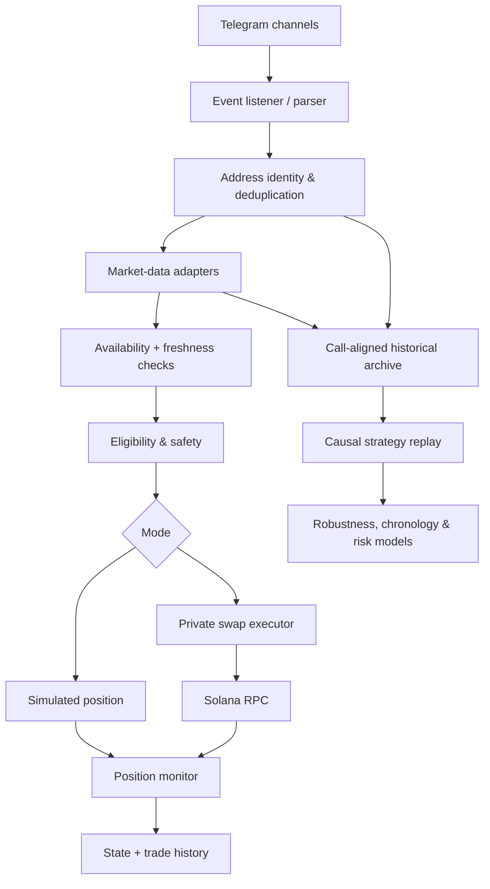

# System architecture (public overview)

The live implementation and its decision logic are private. This document explains integration boundaries and engineering responsibilities rather than disclosing source code or proprietary trading rules.

## 1. Signal ingestion

Telegram client receives messages from configured sources. Parsing normalizes contract addresses, associates messages with the correct source and timestamp, and checks duplicates. A token seen by multiple sources is still a single token for portfolio-position and research purposes.

## 2. Market-data enrichment

Market-data adapters have used Birdeye, GeckoTerminal, DexScreener and supporting SOL/USD reference sources. They distinguish price observations, token metadata and liquidity, rather than treating a single promotional Telegram update as an executed price. Data freshness and availability are first-class properties.

## 3. Decision and safety boundary

The private engine supports both simulation and live operation, with configurable eligibility rules and defensive controls. Risk controls include duplicate-token suppression, safeguards against overlapping positions, and checks for unavailable/inadequate data. Trade decisions should not consume a market-data observation before the data was actually available.

## 4. Swap execution and position management

Earlier prototypes investigated more than one execution path; recent iterations used SolanaTracker swap routing with Solana RPC transaction infrastructure. Critical concerns include routing failures, price impact, confirmation status, fee and slippage assumptions, partial dust balances and failure recovery.

Once a position is active, monitoring handles exit criteria, user controls, persistent state, and post-trade accounting. Historical fills and executable router quotes are not interchangeable.

## 5. Research and replay pipeline

- Historical source call ingestion and address normalization.
- Call-time alignment of market-price and liquidity observations.
- Distinct event time, data availability time, decision time, requested execution time and observed fill proxy time.
- Chronological evaluation, one-position simulation, and per-token deduplication.
- Metrics reporting, missing-data sensitivity, dataset comparisons and reproducibility notes.

## Conceptual architecture

**Separation of concerns:** The public architecture documents responsibilities and external interfaces. It intentionally does not specify production parameters, wallet identity, authentication, API keys or implementation methods.

[Return to overview](../README.md)
