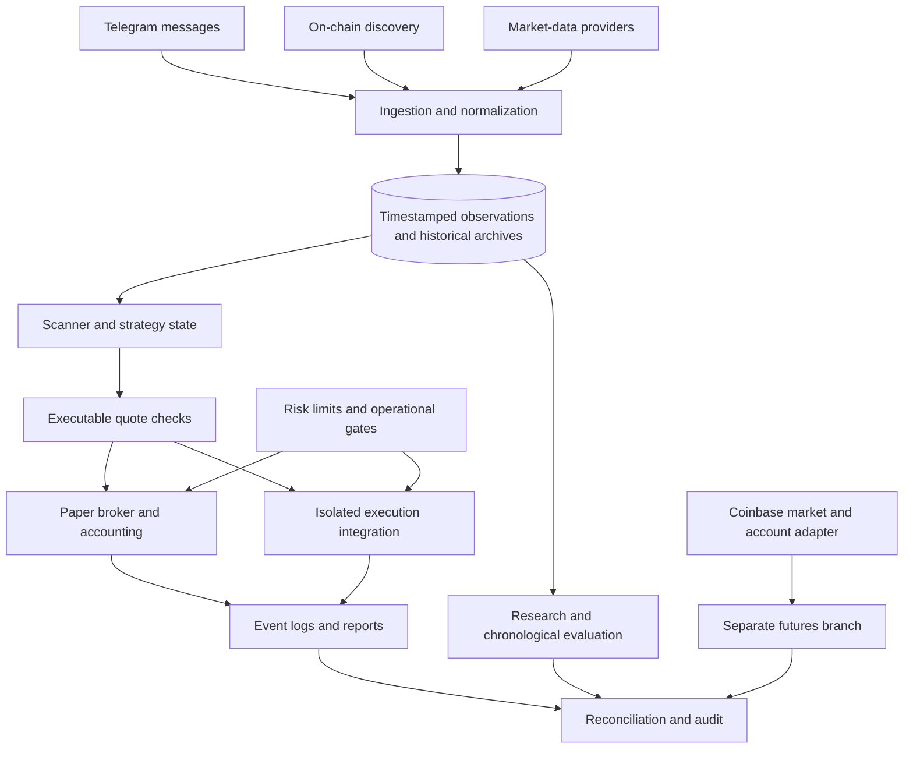

# System architecture

This diagram summarizes recurring boundaries across the project. It is a conceptual map of several generations of software, rather than a claim that all branches run as one deployed system.

## Main boundaries

| Boundary | Responsibility |
|---|---|
| Ingestion | Parse external formats, preserve timestamps, identify tokens, and distinguish calls from later updates |
| Provider adapter | Own HTTP/WebSocket behavior, schemas, retry/backoff, pacing, and error handling |
| Storage | Preserve observations and provenance; support timestamp-bounded reads and deterministic replay |
| Strategy | Evaluate features and state transitions using data observable at the decision time |
| Execution | Separate a signal from an executable quote, a simulated fill, and an actual submitted transaction |
| Risk | Apply position/concurrency limits, freshness checks, exposure constraints, and stop conditions |
| Audit | Rebuild results, reconcile events, inspect timing assumptions, and report limitations |

## Evolution of the design

Legacy scripts combine more responsibilities in single files. Newer packages split them into typed models, adapters, repositories, strategies, brokers, and services.

The spot collector is paper-only. The rebound project has an isolated live boundary whose automated submission remains deferred. Earlier Solana scripts and the separate futures branch contain execution integrations. These statuses must be assessed per component.

## Temporal correctness

A recorded candle timestamp does not automatically mean its value was available then. Decisions need the candle's completion time, provider availability, processing delay, and subsequent execution delay. Historical metadata and missing-exit estimates likewise need a valid information cutoff.

That distinction connects data engineering to trading-system correctness: a fast, well-structured bot can still produce misleading research if its inputs include future information.
