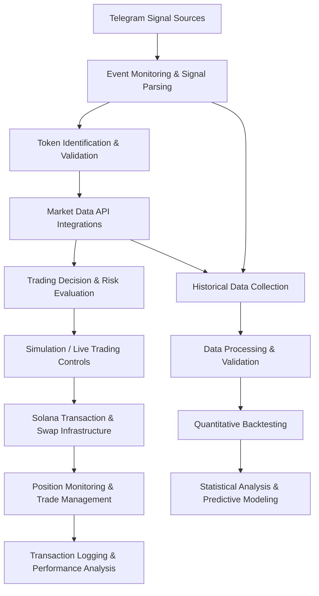
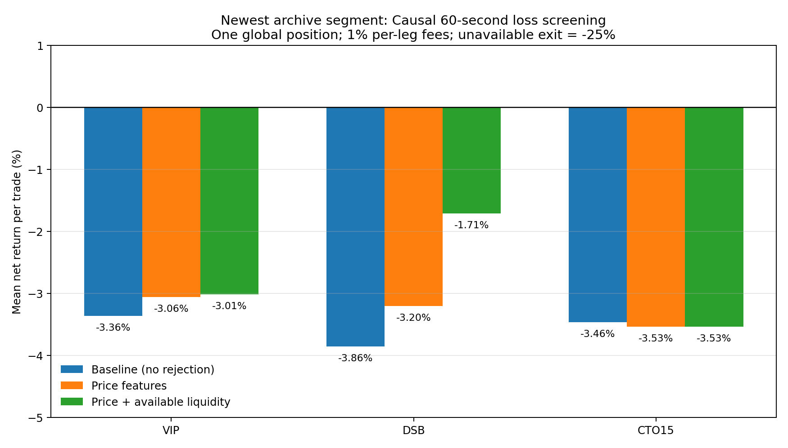

# Solana Trading Systems & Quantitative Research

### Independent Software Engineering, Blockchain Automation & Quantitative Research Project

**Development:** January 2025 - Present  
**Primary Language:** Python  
**Focus:** Software Engineering, API Integration, Blockchain Infrastructure, Data Engineering, Algorithmic Trading, Statistical Analysis, and Machine Learning  
**Status:** Ongoing Independent Research  
**Implementation:** Private | **Documentation:** Public

---

## Project Overview

This repository documents the development of my independent Solana trading automation and quantitative research platform, a long-term personal engineering project that I began in January 2025.

What started as an effort to automate cryptocurrency signal monitoring gradually evolved into a broader software engineering and research system involving real-time Telegram integration, Solana blockchain transactions, external market-data APIs, automated trading infrastructure, large-scale historical datasets, and quantitative strategy evaluation.

Throughout development, I extensively incorporated Large Language Models (LLMs) as engineering and research assistants, using AI-assisted workflows to accelerate implementation, investigate technical problems, develop experimental methodologies, and evaluate results while maintaining independent oversight and validation.

Over the course of development, I have worked on building and improving an automated trading application while studying the statistical reliability and practical executability of algorithmic trading strategies.

The project combines hands-on software development with experimental research, requiring work across several technical disciplines:

- Python application development and asynchronous programming
- Event-driven automation and external API integration
- Blockchain wallet management and Solana transaction infrastructure
- Data collection, normalization, compression, and validation
- Quantitative strategy development and historical backtesting
- Statistical performance evaluation and risk modeling
- Machine-learning-based predictive screening
- Debugging, reliability engineering, and simulation validation

**This is a documentation and engineering portfolio repository.** The proprietary trading implementation, credentials, and private datasets are intentionally excluded.

---

## Project Objectives

The overarching goal of this project has been to design, develop, and evaluate an automated system capable of identifying and responding to trading opportunities on the Solana blockchain.

The project has developed around four objectives:

1. **Automation:** Develop software capable of monitoring external trading signals, evaluating market conditions, and managing trading operations without continuous manual intervention.
2. **System Reliability:** Improve error handling, transaction management, application state persistence, and recovery from external service failures.
3. **Quantitative Research:** Construct historical datasets and evaluate trading strategies using realistic timing, execution-cost assumptions, and rigorous validation.
4. **Predictive Modeling:** Investigate whether observable market characteristics can predict future price behavior, severe downside risk, and transaction executability.

A major focus of the later research has been distinguishing historically profitable-looking price patterns from strategies that can realistically generate positive returns under actual trading conditions.

---

## System Architecture

The platform has evolved through multiple iterations. At a high level, its development encompasses the following components:

*Conceptual representation of the engineering components, not a disclosure of the proprietary implementation or exact production control flow.*

### Core Engineering Components

**Telegram Monitoring and Signal Processing**

Developed Python-based automation for monitoring Telegram channels, extracting Solana token contract addresses, processing message events, and handling incoming trading signals.

**Market Data Integration**

Integrated and investigated external data services for accessing token prices, liquidity, market capitalization, trading activity, and historical price observations.

**Blockchain Transaction Infrastructure**

Worked with Solana wallet integration, RPC interfaces, transaction construction, swap-routing services, and automated order execution.

**Trade and Position Management**

Developed simulated and live trading workflows incorporating position tracking, configurable execution settings, transaction logging, and operational controls.

**Historical Data and Research Infrastructure**

Built workflows for processing large collections of historical calls and market-data observations, aligning event timestamps, constructing backtesting inputs, and evaluating strategies.

**Quantitative Strategy Evaluation**

Implemented and refined simulation methodologies to test trading rules under transaction fees, execution delays, liquidity constraints, position concurrency, and incomplete historical observations.

---

## LLM-Assisted Engineering & Research

Large Language Models (LLMs) have played a significant role throughout the development of this project, serving as tools for software engineering, technical problem-solving, quantitative research, and iterative system improvement.

Rather than using LLMs solely for code generation, I incorporated them into a broader engineering workflow that combines AI-assisted development with independent testing, debugging, experimental validation, and technical decision-making.

### Applications of LLMs

- **Software Development:** Used LLMs to assist with Python implementation, asynchronous programming, API integrations, algorithm development, and code refactoring.

- **Debugging & Troubleshooting:** Applied LLM-assisted code reviews and debugging to investigate runtime errors, transaction execution issues, data-processing failures, and simulation inconsistencies.

- **Quantitative Research:** Leveraged LLMs to brainstorm trading hypotheses, design experimental methodologies, evaluate strategy configurations, and interpret statistical findings across large historical datasets.

- **Data Engineering:** Used LLM-assisted workflows to develop and improve scripts for extracting, cleaning, aligning, compressing, and analyzing historical market data.

- **Statistical Analysis:** Incorporated LLMs into discussions of backtesting methodology, predictive modeling, overfitting, lookahead bias, execution-cost modeling, and out-of-sample validation.

- **Research Documentation:** Used LLMs to help organize experimental findings, explain technical methodologies, compare results, and maintain structured documentation of the project's development.

### Human Oversight & Independent Validation

A major lesson from this project has been that LLM-generated code, analytical interpretations, and proposed strategies must be independently verified.

During the research process, code-level audits identified simulation errors that initially produced misleading profitability results. Correcting these errors invalidated the apparent trading advantage and reinforced the importance of testing AI-assisted implementations against actual data and explicitly defined assumptions.

My engineering workflow emphasizes:

1. Defining the technical problem and expected system behavior.
2. Using LLMs to explore implementation approaches and potential solutions.
3. Reviewing and adapting proposed code and analytical methods.
4. Running tests against historical datasets and examining intermediate results.
5. Investigating inconsistencies, correcting errors, and repeating validation.
6. Retaining or rejecting conclusions based on empirical evidence rather than model-generated confidence.

**LLMs function as development and research assistants, not as substitutes for engineering judgment or experimental verification.**

Their integration into this project has provided practical experience with AI-augmented software engineering, iterative prototyping, debugging, and human-in-the-loop technical research.

---

## Development History

### 2025 | Initial Software Development

The project began in January 2025 with the development of Python scripts intended to automate parts of cryptocurrency monitoring and trading.

Early engineering work centered on Telegram integration, signal recognition, automated workflows, and establishing a functional foundation for interacting with the Solana ecosystem.

The project subsequently expanded into external API integrations, wallet and transaction operations, trade management, and ongoing improvements to reliability.

### 2026 | Expansion into Quantitative Research

The scope broadened substantially toward historical market analysis, simulation, and systematic strategy development.

Research efforts included:

- Building and processing large historical token-call datasets
- Reconstructing token price behavior after Telegram announcements
- Evaluating momentum, breakouts, reversals, and fixed holding periods
- Modeling execution latency, slippage, fees, and unavailable prices
- Investigating liquidity and token lifecycle characteristics
- Comparing strategy behavior across independent signal sources
- Implementing chronological training and evaluation periods
- Auditing simulation logic for lookahead bias and other modeling errors

### October 2026 | Cross-Dataset Validation and Predictive Risk Research

Later research investigated whether trading strategies could demonstrate consistent positive performance across three distinct Telegram signal populations: VIP, DSB, and CTO.

Research explored trailing exits, partial profit-taking, volatility structures, historical regime filtering, token lifecycle adaptation, and extreme-upside behavior.

Further investigations considered whether severe trading losses could be predicted before entry using early price behavior, liquidity information, and statistical learning techniques.

These investigations highlighted both potentially useful predictive relationships and major limitations in the historical data and execution assumptions.

The project remains under active research and development.

For additional detail, see the [Project History](docs/PROJECT_HISTORY.md) and [Development Timeline](docs/01-project-timeline.md).

---

## Quantitative Research

A substantial portion of the project has focused on measuring whether trading strategies perform consistently after accounting for practical execution limitations.

### Historical Datasets

The research has used several independently collected and processed historical signal datasets.

| Dataset | Research Purpose |
|---|---|
| VIP | Large-scale strategy development, historical price analysis, and early-stage token behavior |
| DSB | Cross-dataset validation, price-path comparisons, and alternative token populations |
| CTO | Validation on tokens with different lifecycle characteristics and liquidity profiles |
| Additional signal archives | Channel-level comparisons, signal verification, and exploratory analysis |

Datasets differ in collection coverage, observation frequency, available metadata, and the token populations they represent.

These differences are important when determining whether an apparent trading advantage is genuine or specific to the original dataset.

### Strategy Research Areas

Research has included:

- Momentum-triggered entries and breakout confirmation
- Fixed holding periods and timed exits
- Stop-loss and take-profit mechanisms
- Trailing exits and asymmetric payoff structures
- Partial profit-taking and runner positions
- Volatility compression and expansion
- Post-pump consolidation and reversal patterns
- Market-cap and token-lifecycle segmentation
- Liquidity filtering and pretrade risk screening
- Historical market-regime analysis
- Machine-learning-based downside-risk prediction
- Cross-dataset strategy replication

Thousands of strategy configurations have been evaluated through successive research iterations.

### Research Methodology

A recurring priority has been designing simulations that avoid unrealistic assumptions and misleading performance estimates.

Key methodological practices include:

**1. Chronological Validation**

Separating historical observations into earlier training periods and later evaluation periods to investigate whether strategies generalize beyond their development samples.

**2. Execution-Cost Modeling**

Incorporating simulated transaction fees, delayed execution, adverse price movement, and practical trade-management constraints.

**3. Data Leakage Prevention**

Ensuring trading decisions do not rely on observations unavailable at the simulated decision timestamp.

In particular, historical Birdeye one-minute liquidity observations are subject to a **63-second availability delay** before they can inform simulated decisions.

**4. Missing-Data Sensitivity**

Testing the effects of incomplete historical prices and unavailable exits rather than automatically assuming missing observations represent successful transactions.

**5. Global Position Constraints**

Replaying trading opportunities under restrictions such as a single active position and preventing repeated trades on the same token.

**6. Independent Simulation Audits**

Reviewing strategy simulation code, timestamp handling, price-array boundaries, and execution assumptions to detect implementation errors that could distort research findings.

---

## Research Findings and Engineering Lessons

A central finding of the research is that large historical price movements do not necessarily translate into profitable, executable trading opportunities.

Several important conclusions have emerged:

### 1. Strategy Performance Is Dataset-Dependent

Strategies that appear promising on one historical signal population may perform poorly on others.

Differences in token lifecycle, market capitalization, trading activity, and historical coverage complicate direct comparisons.

### 2. Historical Price Peaks Are Not Guaranteed Executable Returns

Some tokens exhibit extreme short-duration price appreciation.

However, attempting to capture those movements introduces challenges involving execution latency, liquidity, price impact, and rapid price reversals.

### 3. Realistic Assumptions Can Reverse Apparent Profitability

Backtest performance is sensitive to transaction costs, simulated execution delays, missing prices, and unrealistic exit assumptions.

One major research audit identified a simulator boundary-handling error that produced invalid positive results. Correcting that error eliminated the apparent trading advantage.

This reinforced the importance of validating the simulation itself rather than relying solely on favorable performance metrics.

### 4. Early Downside-Risk Prediction Shows Some Promise

Later experiments investigated predicting severe losses using market information available before simulated entry.

Early price behavior and liquidity characteristics demonstrated modest predictive information in some datasets, although the resulting screened strategies did not establish consistent profitability.

### 5. Generalization Matters More Than Optimization Alone

Extensive historical testing has not established a reliably profitable universal strategy across the main VIP, DSB, and CTO datasets under the evaluated assumptions.

This is an important research result rather than a claim of successful automated profitability.

**Current research conclusion:** The system is an ongoing engineering and quantitative research platform. Historical simulations have not established a universally profitable, live-ready strategy.

---

## Research Visualization

The following visualization is from the project's investigation into pretrade downside-risk screening.

The research investigates whether filtering candidates using historical price and liquidity characteristics can improve simulated trading outcomes.

The figure represents historical research and does not establish profitable live execution.

Additional analysis is available in [Quantitative Research](docs/03-quant-research.md) and [Research Results and Limitations](docs/05-results-limitations.md).

---

## Technologies and Tools

The project has involved the following technologies and services across its development and research stages.

| Category | Technologies |
|---|---|
| Programming | Python |
| Telegram Automation | Telethon |
| Blockchain | Solana, solana-py, solders |
| Swap Infrastructure | SolanaTracker |
| Market Data | Birdeye, GeckoTerminal, CoinGecko |
| Data Processing | NumPy, pandas, JSON, gzip |
| Data Visualization | Matplotlib |
| Statistical Research | Python-based simulations and statistical analysis |
| AI-Assisted Development | Large Language Models (LLMs), AI-assisted programming, debugging, research design, and technical analysis |
| Machine Learning | scikit-learn and predictive risk-modeling workflows |
| Networking and APIs | HTTP requests, asynchronous operations, REST APIs |
| Development Environment | Windows, Python, GitHub |
| Research Documentation | Markdown, technical reports, visualization |

The technologies listed represent the broader project lifecycle, not necessarily simultaneous dependencies of any single implementation.

### Open-Source Acknowledgments

Open-source projects and external services have been important to the development of this platform.

Relevant upstream projects include:

- [Telethon](https://github.com/LonamiWebs/Telethon) for Telegram API interactions
- [solana-py](https://github.com/michaelhly/solana-py) for Python-based Solana interactions
- [solders](https://github.com/kevinheavey/solders) for Solana-related Python functionality
- [NumPy](https://github.com/numpy/numpy) for numerical computing
- [pandas](https://github.com/pandas-dev/pandas) for data processing
- [Matplotlib](https://github.com/matplotlib/matplotlib) for research visualization
- [scikit-learn](https://github.com/scikit-learn/scikit-learn) for machine-learning and statistical workflows

These are credited as external technologies. Their original implementations are not claimed as my own work.

For more information, see [Technology and Credits](docs/TECHNOLOGY_AND_CREDITS.md).

---

## Repository Documentation

This repository is organized as a technical portfolio and development record rather than a publicly deployable trading application.

### Project Background and Architecture

| Document | Description |
|---|---|
| [Project Scope](docs/PROJECT_SCOPE.md) | Project objectives, boundaries, and overall scope |
| [Project History](docs/PROJECT_HISTORY.md) | Historical development and progression |
| [System Architecture](docs/ARCHITECTURE.md) | Engineering architecture and component overview |
| [Research Engineering](docs/RESEARCH_ENGINEERING.md) | Research infrastructure and methodology |
| [Technology and Credits](docs/TECHNOLOGY_AND_CREDITS.md) | Technologies, integrations, and acknowledgments |

### Additional Technical Documentation

| Document | Description |
|---|---|
| [Development Timeline](docs/01-project-timeline.md) | Chronological development overview |
| [Architecture Details](docs/02-system-architecture.md) | System design and integration details |
| [Quantitative Research](docs/03-quant-research.md) | Strategy development and historical experimentation |
| [Data Validation](docs/04-data-validation.md) | Dataset processing, alignment, and integrity |
| [Results and Limitations](docs/05-results-limitations.md) | Findings, methodological limitations, and uncertainty |
| [Technical Stack](docs/06-tech-stack-credits.md) | Libraries, frameworks, and related services |
| [Engineering Lessons](docs/07-lessons-roadmap.md) | Technical challenges, lessons, and future work |
| [Privacy and Disclosure](docs/08-privacy-and-disclosure.md) | Public documentation scope and excluded materials |

---

## Current Research Priorities

The primary areas for further investigation include:

1. Improving the quality, synchronization, and completeness of historical market observations.
2. Evaluating actual executable buy and sell quotations rather than relying solely on historical price proxies.
3. Investigating the predictive value of token liquidity, transaction flow, and downside-risk indicators.
4. Improving strategy robustness across different market conditions and token populations.
5. Continuing independent simulation audits and chronological evaluation.
6. Refining automated execution reliability, monitoring, and risk-management infrastructure.

The emphasis is on reproducible engineering, sound experimental methodology, and demonstrating evidence of generalization before drawing conclusions about potential trading profitability.

---

## Privacy, Security, and Source Code

This repository intentionally excludes the project's proprietary implementation and sensitive operational information.

Materials not included publicly consist of:

- Private trading bot source code and proprietary strategies
- Wallet private keys and signing credentials
- API keys and Telegram session credentials
- Private account information and operational configuration
- Unreviewed raw trade records and historical data archives

The repository is provided to showcase engineering work, system design, research methodology, and technical development.

**It is not intended to be a downloadable trading application or a recommendation to trade cryptocurrency.**

---

## Project Status

**January 2025 - Present | Independently Developed | Ongoing**

This project represents an extended independent effort to develop practical engineering skills through software automation, blockchain integration, data processing, and quantitative experimentation.

Its primary value as an engineering portfolio project is the combination of application development, complex third-party integrations, real-world debugging, statistical analysis, and rigorous evaluation of system behavior.

The development and research continue as I investigate opportunities to improve the platform's technical reliability and methodological accuracy.

---

*Independent personal engineering and quantitative research project. Documentation is public; proprietary implementation remains private.*
